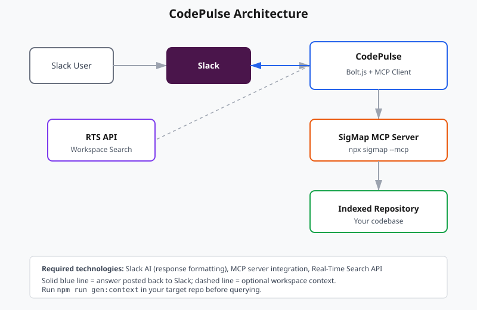

# CodePulse — Final Devpost Submission (Copy-Paste Ready)

Use this file to fill in the Devpost form quickly.

---

## Project Title

CodePulse: Codebase Intelligence Inside Slack Conversations

---

## Tagline / Elevator Pitch

A Slack agent that answers codebase questions directly in thread, using SigMap's MCP server for grounded, file-cited responses.

---

## About The Project

Developers live in Slack. When a codebase question comes up — "where is auth handled?", "who owns the payment service?", "what changed in the rate limiter?" — they leave Slack to search GitHub, their IDE, or ask a teammate. That context switch kills flow.

CodePulse keeps the answer inside the conversation. Mention `@CodePulse` in any channel, ask a codebase question, and get a grounded answer with specific file and method citations in the thread.

## How It Works

1. User `@CodePulse` in a Slack channel or runs `/ask-codebase`.
2. The custom Bolt.js app receives the event and extracts the question.
3. The app invokes SigMap's `query_context` tool via the Model Context Protocol (MCP).
4. SigMap returns ranked code signatures from the indexed repository.
5. The app posts a concise, cited response directly in the thread.
6. Optional: with `ENABLE_SLACK_SEARCH=true`, the app also queries Slack's Real-Time Search API to surface past workspace discussions about the same topic.

## Built With

- Slack Bolt
- Model Context Protocol (MCP)
- SigMap
- Slack Real-Time Search API (optional)

## Key Features

- Grounded answers: every response cites actual files and methods from the repo.
- MCP integration: uses SigMap's stdio MCP server, the exact pattern the hackathon rewards.
- Real-Time Search API: optionally appends past Slack discussions for institutional context.
- Token efficiency: SigMap reduces context to ranked signatures instead of sending full files.
- Authentic moat: SigMap is my own codebase-intelligence product; no other submission can demo this combination.

---

## What Track Are You Submitting To?

Track 1: New Slack Agent

---

## Video Link

[Paste your YouTube/Loom URL here after recording]

---

## GitHub / Source Repository

[Paste public repo URL here if available]

If the repository is private, I can grant Devpost judges access on request.

---

## Try It Out

1. Create a Slack app from `manifest.json` at https://api.slack.com/apps
2. Install dependencies: `npm install`
3. Configure `.env` from `.env.example`
4. Generate context: `npm run gen:context`
5. Start the app: `npm start`
6. In a Slack channel: `@CodePulse what does searchSlackHistory do`

---

## Screenshots

### Screenshot 1: The question

A Slack message in `#backend-team`:

```
@CodePulse what does searchSlackHistory do
```

### Screenshot 2: The grounded response

CodePulse replies with a ranked list from SigMap:

```
Based on SigMap's analysis:

## Query: what does searchSlackHistory do
Intent: search

| Rank | File | Score | Sigs | Penalty |
|------|------|-------|------|---------|
| 1 | src/index.js | 4.47 | 6 | 1.00 |
| 2 | scripts/list-tools.js | 0.00 | 1 | 1.00 |
| 3 | scripts/test-mcp.js | 0.00 | 1 | 1.00 |

### src/index.js
Signals: exactToken=3.00 symbolMatch=1.50 prefixMatch=0.00 pathMatch=0.00 penalty=1.00
```
function isAllowed(channel)  :22-25
function extractSearchKeywords(question)  :29-43
async function searchSlackHistory(client, question)  :45-71
function formatResponse(data)  :73-95
function truncateSlackMessage(text)  :97-100
async function handleQuestion(question, say, client)  :102-119
```
```

### Screenshot 3: Architecture



See `architecture.md` for the full written explanation.

---

## Challenges We Ran Into

- SigMap exposes `query_context`, not `sigmap_ask`, so the integration had to be adapted to the real tool shape.
- MCP stdio servers need the working directory set to the indexed repo; we added `SIGMAP_PROJECT_ROOT` to handle this cleanly.

## Accomplishments That We're Proud Of

- A working end-to-end MCP integration with a real codebase-intelligence engine.
- A custom Slack app that keeps developers in their workflow.
- Optional Real-Time Search API integration that uses all three required Slack technologies.

## What We Learned

- Slack's Socket Mode makes local development fast without public URLs.
- MCP is a clean protocol for grounding LLM responses in live, structured data.

## What's Next for CodePulse

- Line-number citations via SigMap's `get_lines` tool.
- Multi-repo workspace support.
- Automatic indexing on git push.
